# Phage T4, built in ChimeraX

<p class="ph-lead">Inspired by Tom Goddard's <a href="https://www.rbvi.ucsf.edu/chimerax/data/phage-T4-sep2022/phageT4.html">2022 ChimeraX animation of phage T4 tail contraction</a> (RBVI, UCSF). This version uses T4's own tail, head and baseplate structures released since then. It adds simulated host membranes and close-ups, with a build you can repeat by asking Pellaeon.</p>

<!--PHAGE hero-->

## The film

<!--PHAGE film-->

85 seconds, rendered in ChimeraX by a movie script from the same models: 5,094 frames at 3840 × 2160, about 9 hours on one GPU. The proteins use deposited models; the membranes are simulations. See [what is schematic or not shown](#schematic-or-not-shown).

## Close-ups

Twelve views of the same models. Select a numbered dot to name a part. Drag a slider to compare two states; ⤢ opens a larger view.

<!--PHAGE gallery-->

## What you are looking at

<!--PHAGE virion-->

### Infection in six steps

<ol class="ph-beats">
<li><b>Search</b>Long tail fibers, 144 to 160 nm, bind OmpC or lipopolysaccharide (LPS). Binding by three fibers commits the phage to infection. <span class="ph-tag">not shown</span></li>
<li><b>Trigger</b>The baseplate opens from a 52 nm hexagon to a 61 nm star; in the model gp11 turns 95°. The short fibers unfold onto the LPS core. <span class="ph-tag">fiber swing schematic</span></li>
<li><b>Contraction</b>A wave runs from the baseplate to the neck through all 23 sheath rings: rise 39.7 to 16.2 Å, twist 17.2 to 32.9° per ring. The sheath shortens from 925 to 420 Å, the head moves about 50 nm and the tube turns about 345°. In reality this takes under a millisecond.</li>
<li><b>Outer membrane</b>The tube pierces the outer membrane. About 16 nm of the spike, comprising gp5 and gp5.4, is lost on the way.</li>
<li><b>Periplasm</b>The gp5 lysozyme digests peptidoglycan, the cell-wall mesh. The inner membrane, about 30 nm away, bulges about 16 nm to meet the tube tip and fuses with it. <span class="ph-tag">bulge not shown</span></li>
<li><b>Genome</b>168,903 base pairs packed at about 500 mg/ml enter the cell at up to 3 to 4 kbp per second. <span class="ph-tag">not shown</span></li>
</ol>

### Schematic or not shown

- **Long tail fibers and the fibritin whiskers**: not shown. Deposited structures contain only short pieces.
- **Short tail fibers (gp12)**: no extended structure exists. Here they stay folded and swing as rigid bodies with their gp11 trimers.
- **Contraction wave**: the sheath is interpolated between deposited end states (9MKB, 9X3P). The wave's shape and speed are modeled, not imaged.
- **Membranes**: tiled snapshots of all-atom simulations, not experimental structures. LPS covers about 67 % of the outer leaflet; the tile seams are unrelaxed.
- **Inner-membrane bulge and DNA entry**: not shown.
- **Time**: stretched. The real contraction takes under a millisecond.

## Build it with Pellaeon

Type these fourteen requests into Pellaeon in order. Each step shows the request, the commands it ran and the resulting view. By default, running scripts, deleting atoms and saving files wait for your OK.

Use ChimeraX 1.9 or newer. Allow about 6 GB of free memory and 64 MB of downloads ([cost notes](#cost)). Download `t4_parts.py`, `t4_trigger.py` and `t4_wave.py` from [examples/phage-t4](examples/phage-t4/) (MIT license), and put them together in `~/phage-t4`. Start with an empty ChimeraX session so the model numbers match the requests.

### Tried on

One desktop PC: Ubuntu Linux, 32 CPU threads, about 120 GB of RAM and an NVIDIA RTX 4070 SUPER (12 GB). Software: UCSF ChimeraX 1.12 and Pellaeon 0.2.13.

The recorded run used GPT-6 Luna through a ChatGPT sign-in. Steps 5, 6, 8, 9 and 10 used GPT-6 Sol, a stronger model, because Luna did not handle them reliably.

With an earlier wording of these requests, local gemma4:12b on Ollama handled about half the steps, including opening structures, running scripts, saving and playing. It got the rest wrong, including wrong model numbers, chain IDs in the wrong case and selections that matched nothing.

The whole build peaks at about 6 GB of memory in the window. Drawing 5.3 million atoms is the heavy part. Different models, versions and machines will behave differently. Your mileage may vary.

<!--VIDEO phage/phage_t4_tutorial | Fourteen requests in 5 min 18 s. Model waits and animation playback are sped up and marked. One request where the model asked a question instead of acting is cut. | Building phage T4 with Pellaeon, 5 minutes 18 seconds-->

### 1. Open the tail

> open 9mkb, the phage T4 tail with its neck and baseplate

```
open 9mkb
```

9MKB contains the mature virion's tail, neck and baseplate, plus the five capsomers around the portal: 1,533,268 atoms in 541 chains.

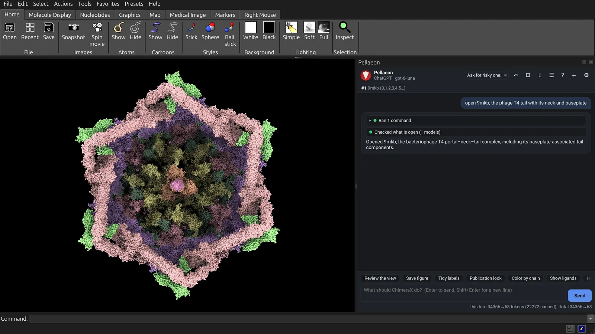

### 2. Add the head as instances

> open 7vs5, the T4 head, and show its assembly 1 as graphical instances, not copies (copies false, newModel false), then fit both models in the view

```
open 7vs5
sym #2 assembly 1 copies false newModel false
view
```

7VS5 contains one fifth of the head (781,038 atoms). Assembly 1 displays it five times: 3.9 million atoms on screen, with one copy in memory. Keep the head as graphical instances to keep memory low.

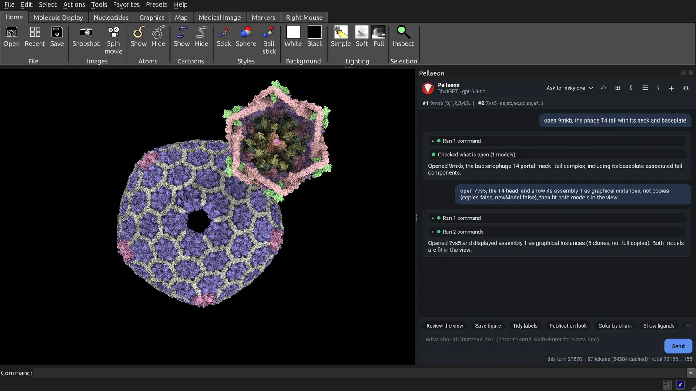

### 3. Put the tail on the head

> put the tail on the head: run matchmaker #1/Ae,Ai,Am,BJ to #2/dt,du,dv,dw pairing ss computeSS false

```
matchmaker #1/Ae,Ai,Am,BJ to #2/dt,du,dv,dw pairing ss computeSS false
```

Both entries contain capsomers beside the portal. Matching four corresponding gp23 chains places the tail on the head. Three details matter:

- **Move the tail, not the head.** Moving the instanced head would place only its first copy; moving the tail keeps all five together.
- **Give the chain IDs.** With 541 chains in 9MKB, the model does not find them on its own.
- **`computeSS false`** skips recalculating secondary structure for 2.3 million atoms: 11 s and 3 GB instead of 120 s and 46 GB.

One capsomer places the head within about 15 Å of a fit on all five, close enough at this scale.

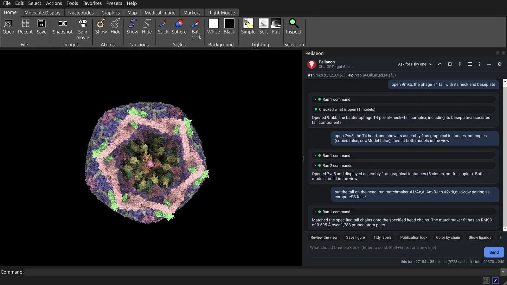

### 4. Name the parts

> run the script ~/phage-t4/t4_parts.py

```
open ~/phage-t4/t4_parts.py
```

[`t4_parts.py`](examples/phage-t4/t4_parts.py) gives groups of chains names such as `head`, `neck`, `sheath` and `hub`. Later requests can use these names instead of chain IDs.

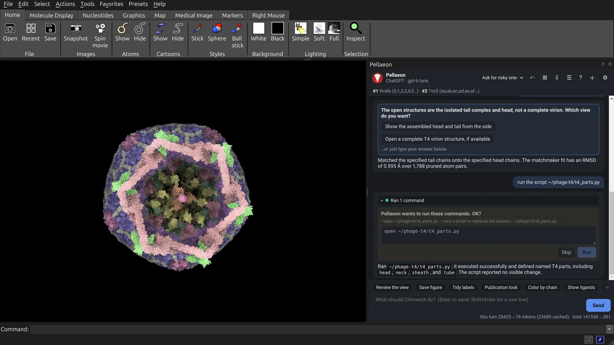

### 5. Remove the duplicate capsomers

> delete capsid9mkb: those gp23 and Soc chains of #1 are already in the head model

```
delete #1 & capsid9mkb
```

The head model already supplies these parts. Remove the overlapping 30 gp23 and 10 Soc chains from 9MKB.

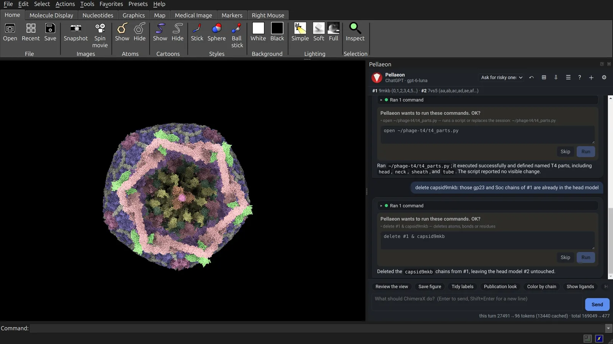

### 6. Color by part

> color the named parts as they are, with the Catppuccin Mocha palette: color head #F5E0DC, soc #F5C2E7, neck #B4BEFE, sheath #89B4FA, tube #F9E2AF, inner #CBA6F7, outer #94E2D5, socket #FAB387, stf #A6E3A1, hub #F38BA8, other #BAC2DE

```
color head #F5E0DC
color soc #F5C2E7
color neck #B4BEFE
color sheath #89B4FA
color tube #F9E2AF
color inner #CBA6F7
color outer #94E2D5
color socket #FAB387
color stf #A6E3A1
color hub #F38BA8
color other #BAC2DE
```

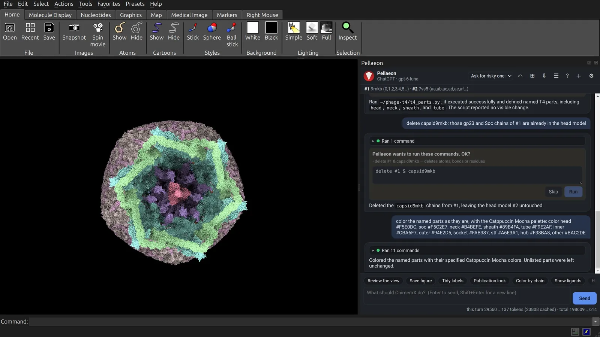

### 7. Show the whole virion

> show #1 and #2 as spheres, background #1E1E2E, lighting full, silhouettes on in #0E0F18, and show the whole virion from the side

```
show #1 atoms
show #2 atoms
style #1 sphere
style #2 sphere
set bgColor #1E1E2E
lighting full
graphics silhouettes true color #0E0F18
view
```

The sphere view shows the packed atoms. Shadows and outlines separate the parts.

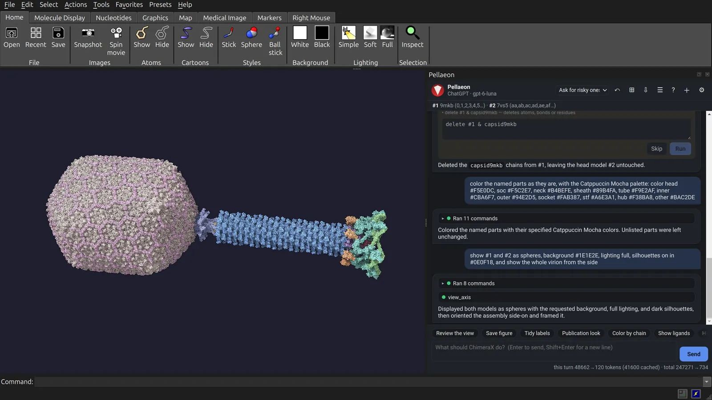

### 8. The baseplate from below

> look at the baseplate from below, straight up the tail axis

```
turn y 180
view hub
view outer
```

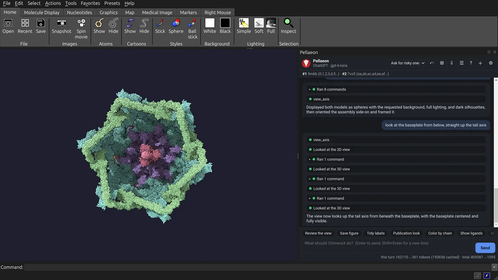

### 9. The neck

> turn back to a side view of the whole virion, then zoom in on the neck part, where the tail joins the head

```
view neck
```

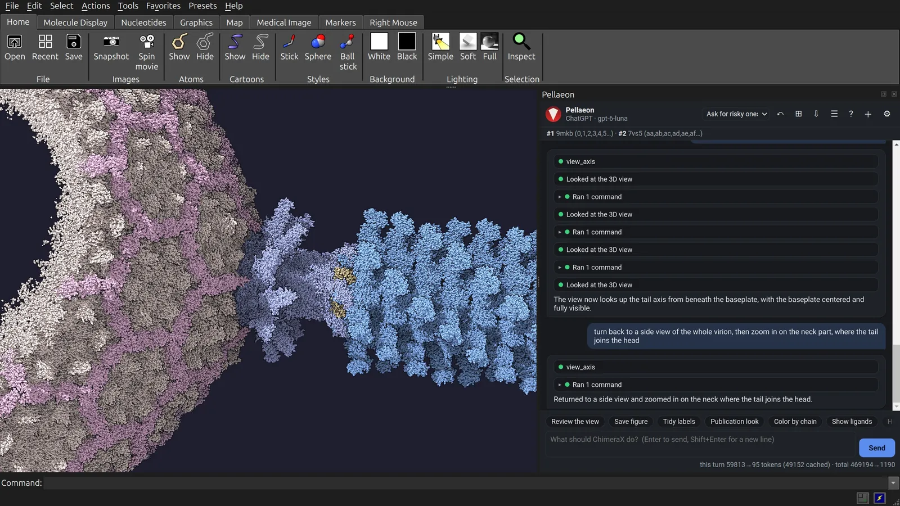

### 10. The cell-puncturing spike

> hide everything except hub, show hub as cartoon and give me a side-view close-up of the needle

```
hide #1,2 target acs
cartoon hub
view hub
zoom 1.7
```

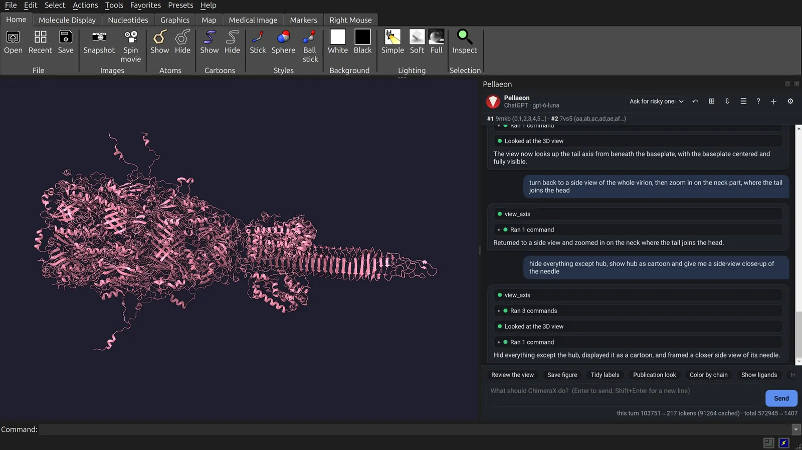

### 11. Save an image

> save this view with the save command as ~/phage-t4/needle.png, 1920 by 1080, supersample 3

```
save ~/phage-t4/needle.png width 1920 height 1080 supersample 3
```

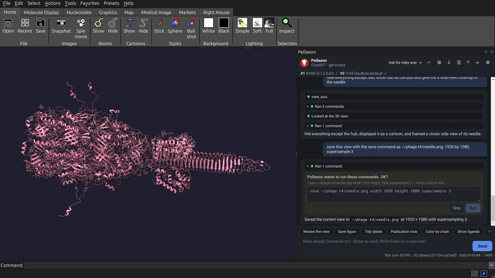

### 12. Back to the virion

> show #1 and #2 again as spheres without the cartoon and show the whole virion from the side

```
show #1,2 atoms
hide #1,2 cartoons
style #1,2 sphere
view
```

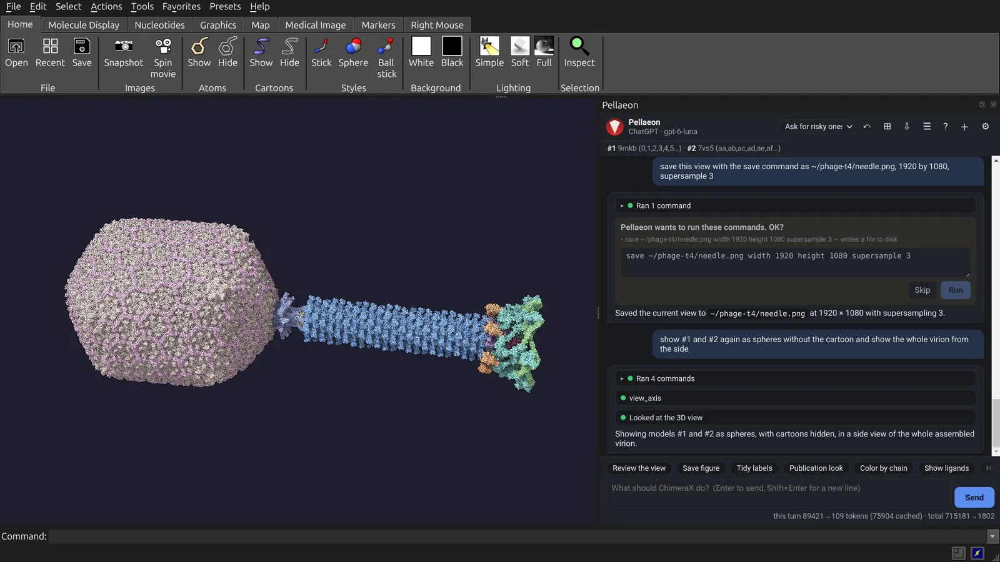

### 13. Add the trigger and contraction

> run the script ~/phage-t4/t4_trigger.py

```
open ~/phage-t4/t4_trigger.py
```

[`t4_trigger.py`](examples/phage-t4/t4_trigger.py) needs [`t4_wave.py`](examples/phage-t4/t4_wave.py) beside it. It fetches 9X3P, 9X3Q, 9X3R and 5IV7, fits them to the open tail and adds `t4motion`.

Values from 0 to 1 open the baseplate; 1 to 2 contract the sheath. Atoms matched between structures use deposited coordinates at both ends. The motion between them is modeled.

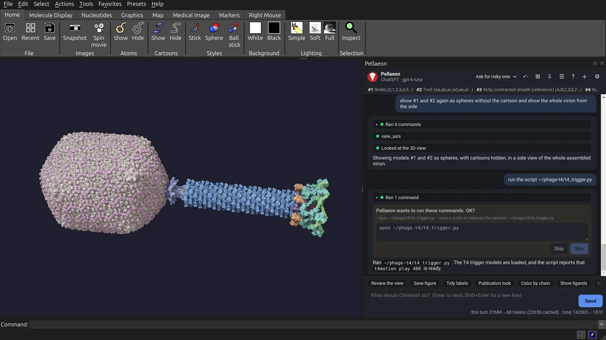

### 14. Play it

> switch to simple lighting so it plays smoothly, then play the baseplate trigger and the contraction over 120 frames with the t4motion command

```
lighting simple
t4motion play 120
```

Each frame moves 1.4 million atoms and the five head copies. Simple lighting avoids recalculating shadows at each frame. Playback reached about 1.5 frames per second on this PC. To record a movie, use `movie record` before playback and `movie encode` afterwards.

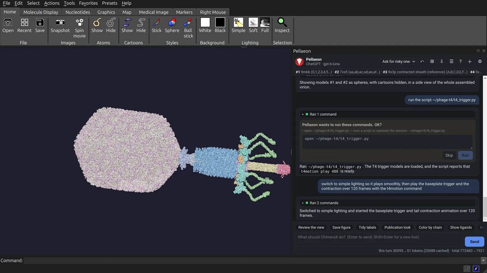

### Cost

Allow 64 MB of structure downloads and about 6 GB of free memory for the virion build. The membrane is separate.

| Download or task | Download size | Time | Memory |
|---|---|---|---|
| Tail: 9MKB | 34.5 MB | 5 s | 1.5 GB |
| Head: 7VS5, 5 instances | 18.9 MB | 5 s | +0.4 GB |
| Fit, `computeSS false` | | 11 s | 3.0 GB |
| Fit, secondary structure recalculated (avoid) | | 120 s | 46 GB |
| Motion: 9X3P, 9X3Q, 9X3R, 5IV7 | 11 MB | 9 s | +0.4 GB |
| Whole build | 64 MB | 10 min | 5.4 GB |

These measurements use the PC described above. Individual steps used cached downloads and ChimeraX without a window. The whole build includes the graphics window. Memory figures are peaks; + marks an increase.

### The membrane

The film includes a simulated E. coli K-12 cell envelope. Its 300 × 300 nm patch contains 32 million heavy atoms. The patch is separate from the fourteen-step build and is not available for download.

The outer membrane uses tiled all-atom snapshots, with rough LPS outside and phospholipids inside (Gutishvili 2025). OmpC trimers sit at one per 200 nm² (PDB 2J1N, oriented as in OPM). The envelope also contains one peptidoglycan layer (Boags et al. 2018) and an inner membrane (Nygaard and Nesterenko 2025). The inner membrane sits 30 nm below the outer one, as measured at T4 infection sites (Hu et al. 2015).

For your own patch, tile deposited bilayer snapshots or use CHARMM-GUI Membrane Builder (Jo et al. *J Comput Chem* 29:1859, 2008; Lee et al. *J Chem Theory Comput* 15:775, 2019). Remove molecules that overlap at tile seams and around proteins. The seams here are unrelaxed; LPS covers about 67 % of the outer leaflet.

## Credits

**Inspiration.** Tom Goddard's [ChimeraX phage T4 injection animation](https://www.rbvi.ucsf.edu/chimerax/data/phage-T4-sep2022/phageT4.html) (RBVI, UCSF, 2022) inspired this page and its contraction-wave approach. The wave here uses separate code with T4 values.

**Structures and maps** (PDB and EMDB data are CC0):

- 9MKB, EMD-48324: Fokine A, et al. In situ structures of the portal-neck-tail complex of bacteriophage T4 inform a viral genome positioning mechanism. *Nat Commun* 2026. [doi:10.1038/s41467-026-69106-8](https://doi.org/10.1038/s41467-026-69106-8)
- 7VS5: Fang Q, et al. *PNAS* 2022. [doi:10.1073/pnas.2203272119](https://doi.org/10.1073/pnas.2203272119)
- 9X3P, 9X3Q, 9X3R: Shao Q, et al. Cryo-EM structures of phage T4 infection intermediate. *J Mol Biol* 438:169938 (2026). [doi:10.1016/j.jmb.2026.169938](https://doi.org/10.1016/j.jmb.2026.169938)
- 5IV7 (used only to place 9X3R): Taylor NMI, et al. *Nature* 2016. [doi:10.1038/nature17971](https://doi.org/10.1038/nature17971)
- 2J1N: Baslé A, Rummel G, Storici P, Rosenbusch JP, Schirmer T. *J Mol Biol* 362:933 (2006); orientation from OPM (Lomize et al. *Nucleic Acids Res* 40:D370, 2012).
- wwPDB consortium. *Nat Struct Biol* 10:980 (2003).

**Dimensions and the infection sequence:** Leiman PG, et al. *Virol J* 7:355 (2010), [doi:10.1186/1743-422X-7-355](https://doi.org/10.1186/1743-422X-7-355); Hu B, et al. *PNAS* 2015, [doi:10.1073/pnas.1501064112](https://doi.org/10.1073/pnas.1501064112).

**Membranes** (CC BY 4.0, tiled): Gutishvili G. Martini 3 SI data, Zenodo 2025, [doi:10.5281/zenodo.18009953](https://doi.org/10.5281/zenodo.18009953); Nygaard OL, Nesterenko A. Simulation of model inner bacterial membrane (CHARMM36), Zenodo 2025, [doi:10.5281/zenodo.16842791](https://doi.org/10.5281/zenodo.16842791); Boags A, Samsudin F, Khalid S. Zenodo 2018, [doi:10.5281/zenodo.1636577](https://doi.org/10.5281/zenodo.1636577) (Boags et al. *Structure* 27:713, 2019).

**UCSF ChimeraX.** Molecular graphics and analyses performed with UCSF ChimeraX, developed by the Resource for Biocomputing, Visualization, and Informatics at the University of California, San Francisco, with support from National Institutes of Health. Meng EC, et al. *Protein Sci* 32:e4792 (2023).

Made with Pellaeon ([doi:10.5281/zenodo.23395411](https://doi.org/10.5281/zenodo.23395411)). To cite it: Amir, Y. Pellaeon: an AI assistant for UCSF ChimeraX. Zenodo. https://doi.org/10.5281/zenodo.23395411

<!--PHAGE script-->
