# Pellaeon tutorial

The full walkthrough takes about twenty minutes: hemoglobin, a residue and its neighbours, a figure, a distance, an AlphaFold model by gene name, variants, two conformations of an enzyme, and your own data. Each step shows what to type, what Pellaeon ran, and what ChimeraX shows afterwards. Where a step was recorded in ChimeraX, **Watch this step** under it plays a short clip; waits for the model are sped up in the clips and marked.

## Five-minute version

1. In ChimeraX's **Command:** line, paste `toolshed install ChimeraX-Pellaeon` and press Enter, then open **Tools ▸ General ▸ Pellaeon**.
2. The panel opens on its settings page. Pick **ChatGPT** and sign in if you have a Plus or Pro account (no key), else **Mistral** (free key) or **Ollama** (runs on your computer). Press **Test connection**.
3. Press **Run a first request**: it saves the settings, opens ubiquitin and colors it by chain.
4. Type these into Pellaeon's message box, one at a time:

    - `close everything and open 4hhb`
    - `color it by chain and show the heme groups as spheres`
    - `make it look publication ready`

5. Press ↶ in the panel's top bar to take the last request back.

## Short tutorials

Four requests each, recorded in ChimeraX, with the commands and the result after every step:

- [A ligand in its pocket](pocket.md): HIV protease and indinavir; pocket surface, hydrogen bonds, close-up.
- [Electrostatics and hydrophobicity](surfaces.md): p53 on DNA; surface colored by potential and by hydrophobicity.

The rest of this page is the full walkthrough.

## Part 1: Setup

### 1. Install ChimeraX and Pellaeon

1. Install [UCSF ChimeraX](https://www.cgl.ucsf.edu/chimerax/download.html) 1.9 or newer (Windows: run the installer with the defaults).
2. Start ChimeraX. Click into the **Command:** line at the bottom of the window, paste this and press Enter:

```
toolshed install ChimeraX-Pellaeon
```

That installs Pellaeon from the [ChimeraX Toolshed](https://cxtoolshed.rbvi.ucsf.edu/apps/chimeraxpellaeon). The menu route does the same thing without typing: **Tools ▸ More Tools…**, find **Pellaeon**, press **Install**.

Open the panel from the menu: **Tools ▸ General ▸ Pellaeon**. It opens as a floating window (drag it onto an edge of the ChimeraX window to dock it) and comes back the next time you start ChimeraX.

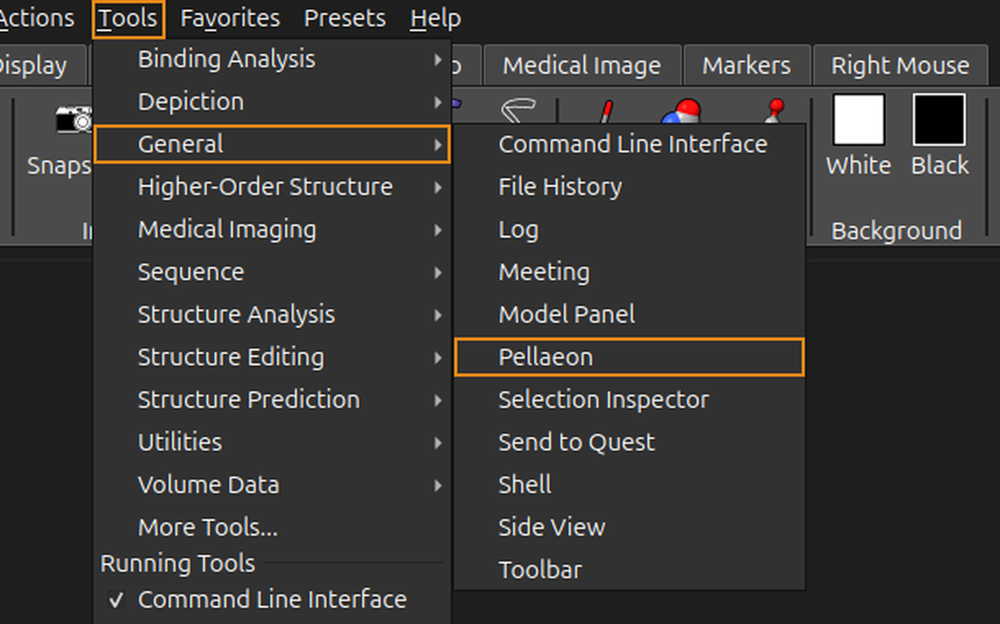

Or type `ui tool show Pellaeon` in the command line. Nothing else to install: no Python, no terminal, no admin rights. (For an offline install, see [Installation](install.md).)

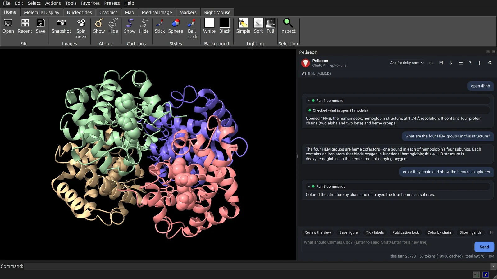

### 2. Connect an AI (once)

The panel opens on its settings page. The choices:

- **A ChatGPT Plus or Pro account (recommended if you have one):** pick **ChatGPT**, press **Sign in with ChatGPT**, and sign in in the browser. No key; Pellaeon uses `gpt-6-sol`, the highest score in the feature comparison on [Tested models](models.md).
- **Nothing to install, free:** pick **Mistral**, click "get a key", sign up at console.mistral.ai, press *Create new key*, and paste it into Pellaeon. Free, no credit card, takes two minutes. Pellaeon uses `ministral-8b-latest`, which the free tier serves at about 190 requests a minute. Google Gemini is an equally good choice at 15 requests a minute; its key comes from AI Studio the same way.
- **The AI runs on your computer:** pick **Ollama**. Pellaeon checks whether Ollama is installed; if not, it offers the download link (ollama.com, a normal installer). After installing, press **Pull** next to `gemma4:12b` once (8 GB, needs a 12 GB GPU; on a smaller card pull `qwen3:8b`, on a laptop `qwen3:4b` and expect slower answers).

One thing to know before you paste a cloud key. With a local Ollama server, model requests are processed on your computer. Fetching structures and annotations still contacts external databases (PDB, AlphaFold DB, UniProt, ClinVar, ConSurf-DB). With a cloud provider, your request, the list of open models, the current selection, the commands you ran by hand in ChimeraX since your previous request (with their output) and any table you loaded are sent to that provider. Screenshots are shared only when the review-the-view option is enabled in Settings. The free tiers of Mistral and Gemini are evaluation tiers, and both providers may use what you send to improve their models: for unpublished work use Ollama, or check the provider's data-handling terms first ([Mistral](https://mistral.ai/terms), [Google](https://ai.google.dev/gemini-api/terms)).

Press **Test connection**, then **Save & use**, or **Run a first request**, which saves the settings and has the AI open ubiquitin and color it by chain. You can switch providers any time with the gear icon.

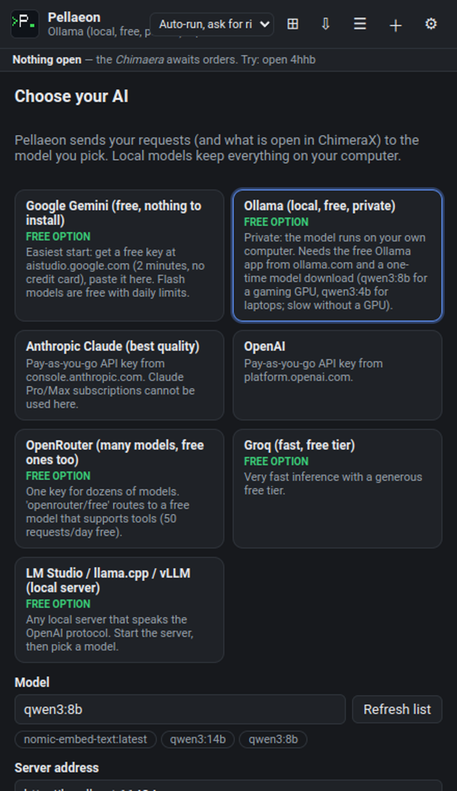

<!--CLIP part7_safety_settings | 0:03 | The settings page and its providers-->

## Part 2: Step by step

Start from an empty session: if the first request opened ubiquitin for you, say "close everything" (it asks for confirmation) before Step 1. The model numbers in the text below assume you did, so hemoglobin is model #1.

Type each request into the box at the bottom and press Enter. Typos and casual phrasing are fine. Most pictures on this page were rendered on a white background with silhouettes (`set bgColor white; lighting soft; graphics silhouettes true`); yours will be on black until step 4, which is fine. The window pictures and clips show ChimeraX as it opens, on black.

### Step 1 · Open a structure

> open 4hhb

Pellaeon fetches human hemoglobin from the PDB and tells you what it found: four chains (two alpha, two beta), heme groups and a phosphate.

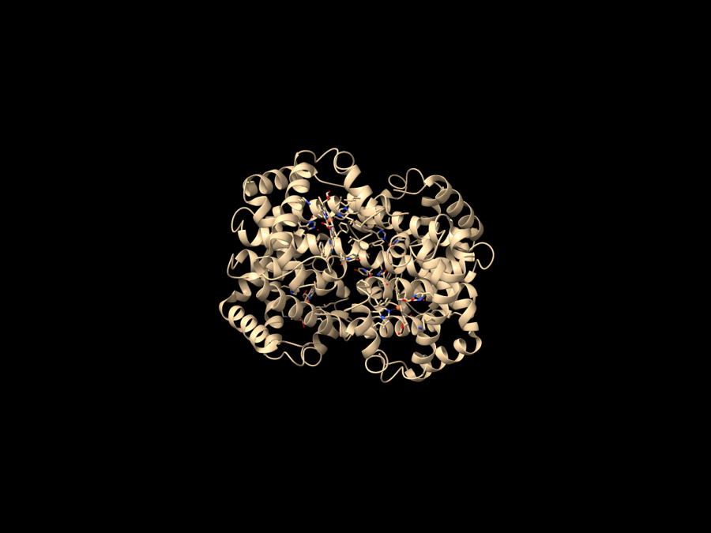

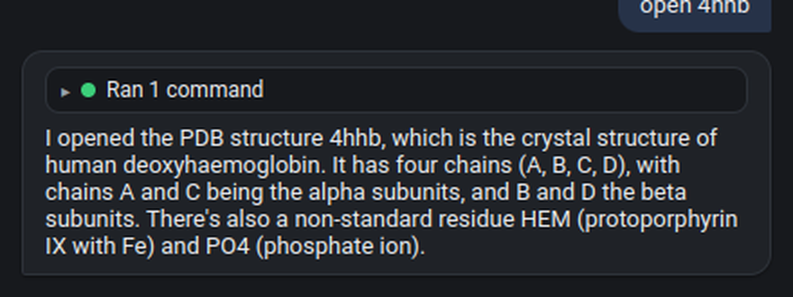

The **Ran 1 command** line is the exact ChimeraX command it used. Click it to expand; every command has *copy*, *rerun* and *?* (opens ChimeraX's own documentation for that command).

<!--CLIP part1_first_open | 0:09 | Step 1, open 4hhb-->

### Step 2 · Color and style

> color it by chain and show the heme groups as spheres

"it" means the model you just opened. The chains get different colors and the four hemes appear as spheres.

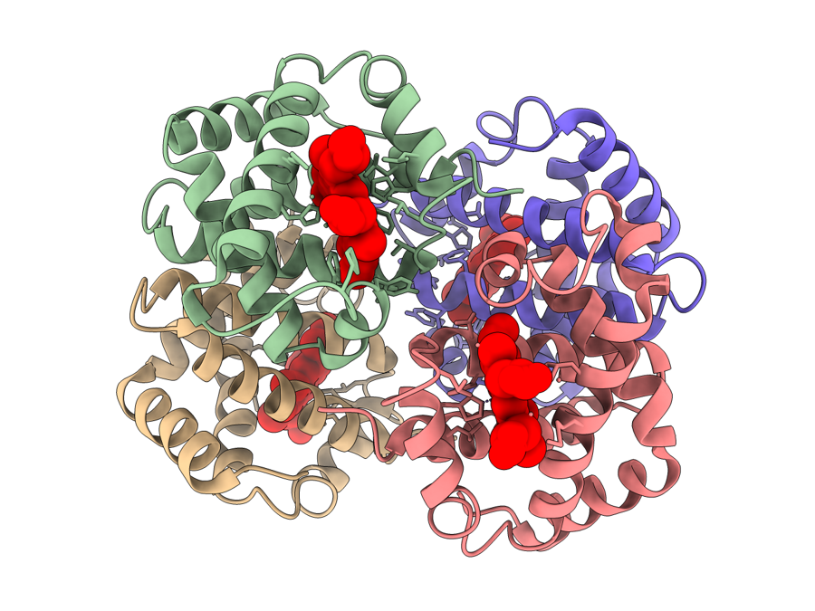

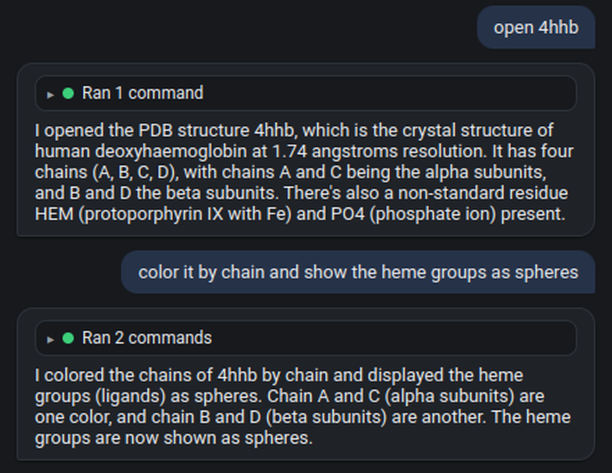

Not what you wanted? Press ↶ in the panel's top bar. ChimeraX goes back to how it was before the last request, and a notice names the request that was undone.

<!--CLIP part1_first_color | 0:15 | Step 2, color by chain and hemes as spheres-->

### Step 2b · Make it move

> make it spin

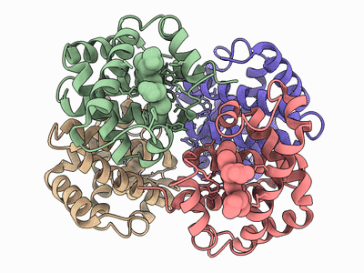

"stop it" stops. "slower", "spin the other way", "rock it back and forth" all work.

### Step 3 · Click on something and ask about it

Ctrl-click any atom in the 3D view (that is ChimeraX's normal way of selecting); to get exactly this example, type `select #1/A:87` in ChimeraX's command line (`#1` is hemoglobin, the first model). A bar appears above the input. **Highlight** colors the selection and shows its atoms; the questions send it to the AI. Alt-click asks about a residue directly, without selecting first (the `pellaeon ask` mouse mode; rebind it with `ui mousemode alt leftMode "pellaeon ask"` if you use Alt for something else).

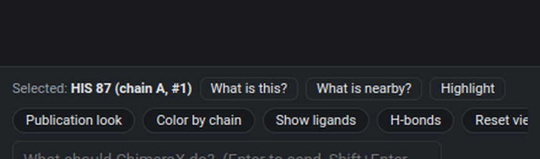

Press **What is nearby?** (or type your own question). **Why this color?** answers from Pellaeon's own record of what colored the residue (step 3b). Pellaeon looks up the residues and ligands within 5 Å, shows them as sticks and labels them:

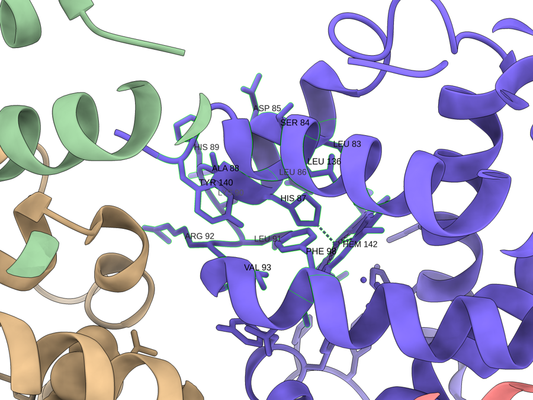

His 87 of chain A is the proximal histidine that holds the heme iron; the sticks around it are the heme and its pocket. Both quick actions put your selection back when they finish, so the next one still means the residue you clicked.

<!--CLIP part2_closer_nearby | 0:08 | Step 3, what is nearby His 87-->

### Step 3b · Why is this residue this color?

Select a residue and press **Why this color?**, or type it. The answer is about the residue you clicked, from Pellaeon's record of what colored it: its current colors and labels, the command, annotation, table or comparison that set them, the other commands that touched it, and any value behind them. It does not guess a biological reason.

> Why is residue 87 (HIS) of chain A in 4hhb this color?

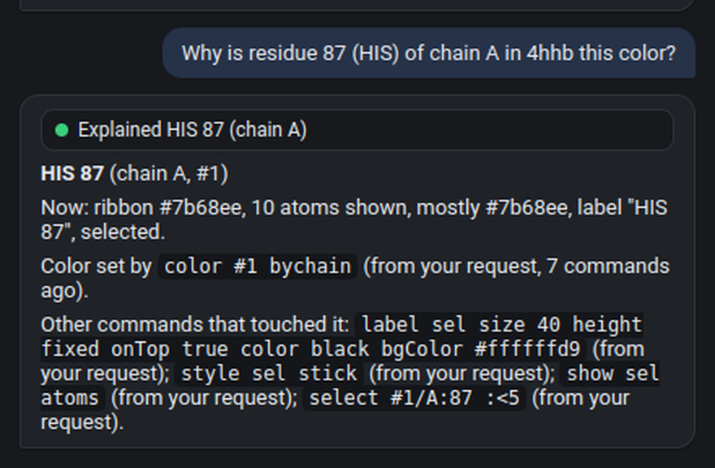

A command that runs without error but matches nothing (wrong residue numbers, wrong chain) is marked *changed nothing* with an amber dot, and the model is told to fix it, instead of getting a green tick.

<!--CLIP part2_closer_why | 0:10 | Step 3b, why His 87 has its color-->

### Step 4 · Make it look like a figure

> make it look publication ready and focus on the heme of chain A, shown as sticks with its iron as a small sphere

This applies ChimeraX's publication preset and centres the view on the heme of chain A:

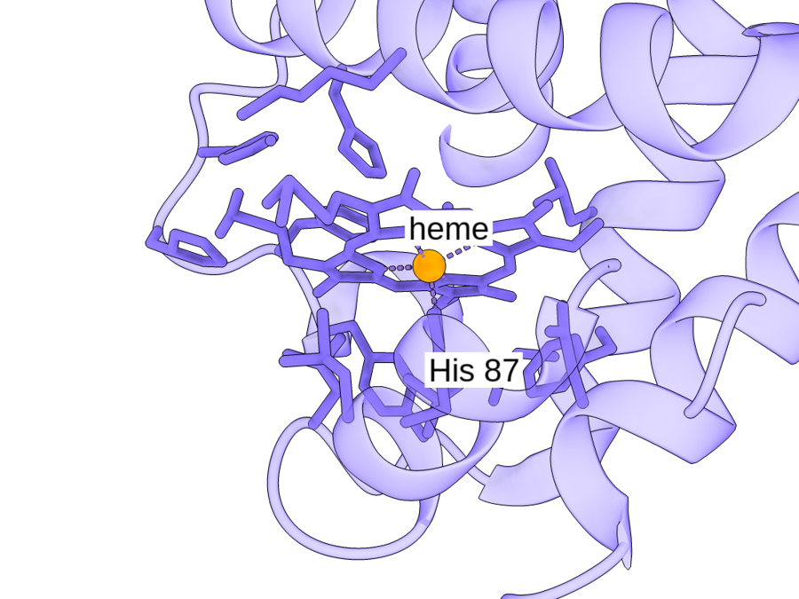

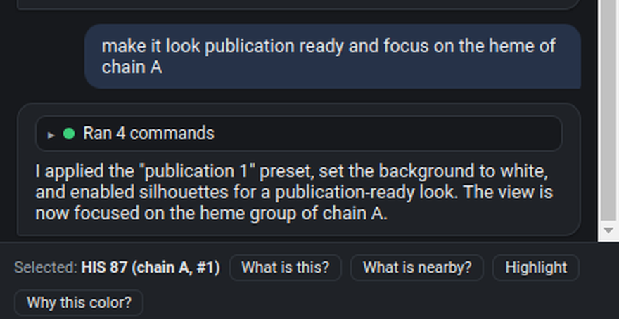

To save it: "save a picture to my desktop". Saving writes a file, so Pellaeon shows a confirmation card first (Step 10).

<!--CLIP part3_figure_publication | 0:12 | Step 4, the publication look-->

### Step 5 · Measure something

> measure the distance between the heme iron of chain A and NE2 of His 87

NE2 is the side-chain nitrogen of His 87 that binds the heme iron: 2.143 Å, shown in the 3D view and in the reply. The CA of residue 87 instead gives the iron to backbone distance, about 6.5 Å. Angles, hydrogen bonds ("show hydrogen bonds"), clashes and contacts work the same way.

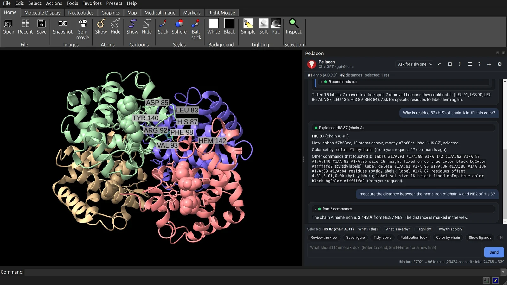

<!--CLIP part2_closer_distance | 0:17 | Step 5, a distance-->

### Step 5b · Save a figure you can reproduce

Do this now, while hemoglobin is still open. Press **Save figure** above the composer (or say "save this as a figure called heme_pocket"). Pick a name and a folder, a size, optionally a close-up (an atom spec such as `#1/A:87 :<6`, the residues within 6 Å of His 87), and press **Save**.

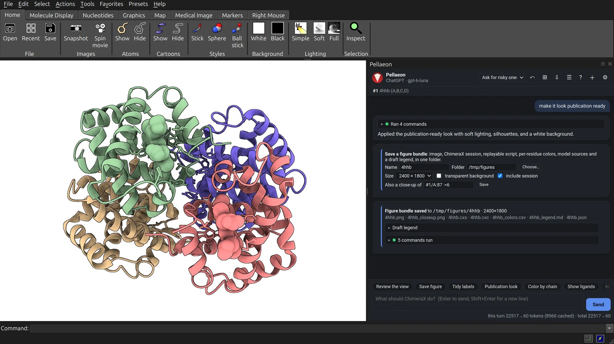

The folder contains more than the picture:

| File | What it is |
|---|---|
| `<name>.png`, `<name>_closeup.png` | the image, plus the close-up if you asked for one |
| `<name>.cxs` | a ChimeraX session (when *include session* is ticked): reopen and keep working |
| `<name>.cxc` | the commands Pellaeon recorded, replayable with `open <name>.cxc`; mouse rotations and commands typed outside Pellaeon are not in it, the session is |
| `<name>_colors.csv` | ribbon and atom color of every residue |
| `<name>_legend.md` | a draft legend written only from the recorded commands, annotations and tables |
| `<name>.json` | structures and their sources (PDB id, AlphaFold accession or file), camera, background, sizes |

When the AI saves a figure on its own the image save asks for your OK first, like any other file write.

<!--CLIP part3_figure_saved | 0:13 | Step 5b, save a figure bundle-->

### Step 6 · Open an AlphaFold model by gene name

> close everything, then open the AlphaFold model of the gene ADRB2

Pellaeon looks the gene up in UniProt (ADRB2 is the beta-2 adrenergic receptor, accession P07550) and opens the AlphaFold model. AlphaFold models are colored by confidence (pLDDT): dark blue very confident, light blue confident, yellow low, orange very low. Confidence in the prediction of that stretch, not experimental evidence and not motion.


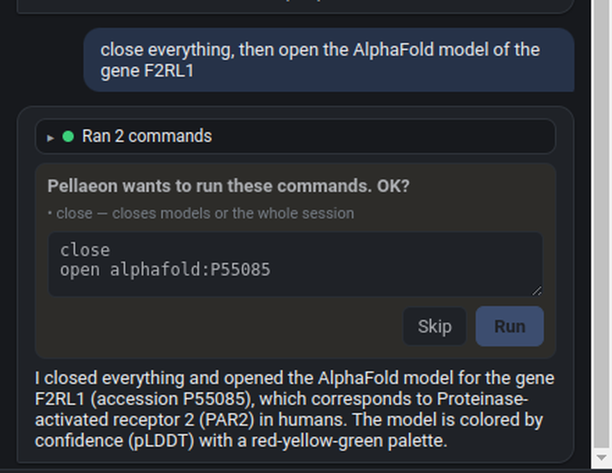

"close everything" asked for confirmation first: closing models is one of the risky actions. "add a color key for the confidence colors" draws a key in the same palette, labelled with its stops (0, 50, 70, 90, 100).

<!--CLIP part4_gene_alphafold | 0:14 | Step 6, the AlphaFold model of ADRB2-->

### Step 6b · Numbering from a paper

> open 2rh1 as a teal cartoon, receptor only: no T4 lysozyme, ligands or water. Align it to the AlphaFold model, show UniProt residue 211 of 2rh1 as a labelled sphere, and fit both in the view

The AlphaFold model uses UniProt numbering. Experimental structures often do not: a missing initiator methionine, an expression tag or a construct that starts at residue 20 shifts every number. Pellaeon aligns 2RH1 to the AlphaFold model, maps the UniProt position through the chain's own UniProt alignment and reports the residue before anything is shown: UniProt residue 211 is Pro 211 of 2RH1. Ask "color UniProt positions 120 to 135 orange" and it maps them first. A position that cannot be placed changes nothing, and the result says so.

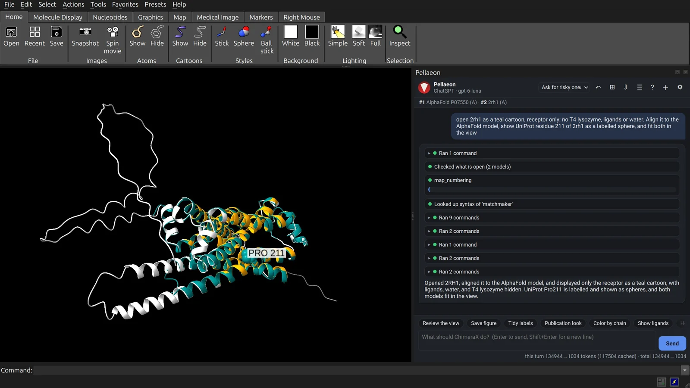

<!--CLIP part4_gene_numbering | 0:19 | Step 6b, UniProt 211 in 2RH1-->

### Step 6c · Bookmark a view

> highlight residue 113, pull back so the whole receptor is visible, and bookmark this view as pocket

> now show the whole thing, then go back to the pocket view

Bookmarks are ChimeraX's named views: Pellaeon lists the ones you have saved in what it tells the model, so "back to the pocket view" works, and "make a movie touring my bookmarks" produces a fly-through (the encode step asks for your OK, like any file save).

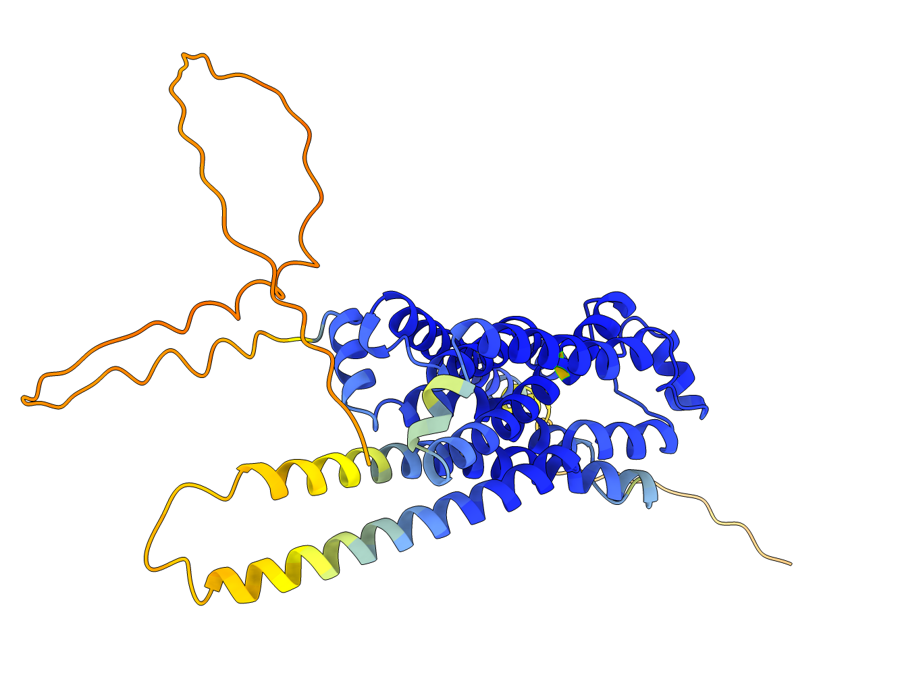

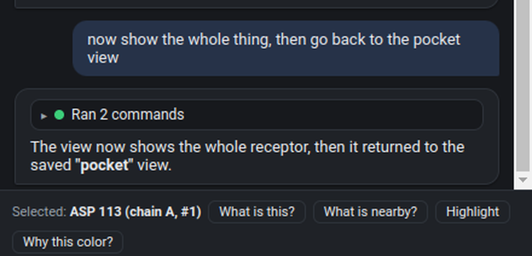

### Step 7 · Paint annotations from UniProt

> color the transmembrane helices orange and the rest white

Pellaeon fetches the transmembrane segments from UniProt and colors exactly those residues. The seven helices of this receptor light up:

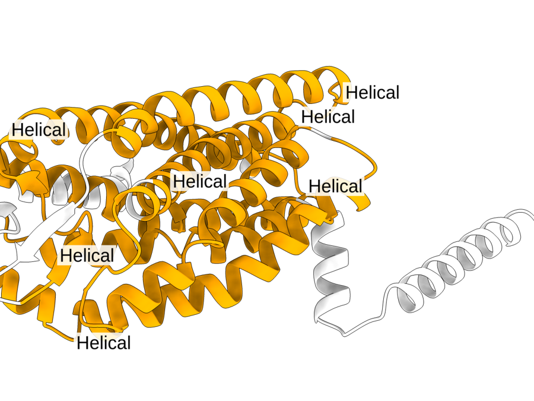

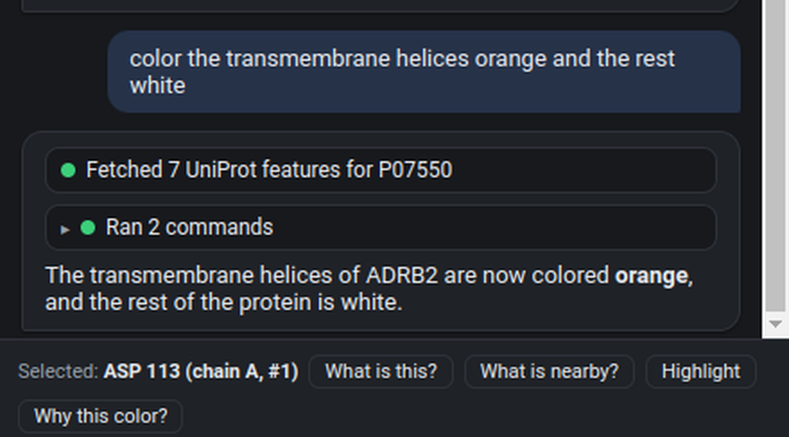

The same works for domains, binding sites, active sites, glycosylation, disulfides. A color key left over from the confidence coloring is removed in the same batch.

<!--CLIP part4_gene_tm | 0:18 | Step 7, the transmembrane helices-->

### Step 8 · ClinVar variants

> close everything and open the AlphaFold model of the gene HBB

> show the ClinVar variants of HBB on it

Hemoglobin beta again, this time the AlphaFold model, with the ClinVar missense positions that mapped onto the model colored by clinical significance: red pathogenic, orange likely pathogenic, magenta conflicting, yellow uncertain, cyan and blue (likely) benign. When several variants share a position, the color shows the highest-priority classification: pathogenic, then likely pathogenic, then uncertain, then likely benign, then benign; the card lists all of them. The pathogenic ones are labeled; E7V is the sickle-cell mutation (ClinVar counts the initiator methionine, so it is Glu6→Val in mature-chain numbering). This is the AlphaFold model of one β chain, not the tetramer from step 1.

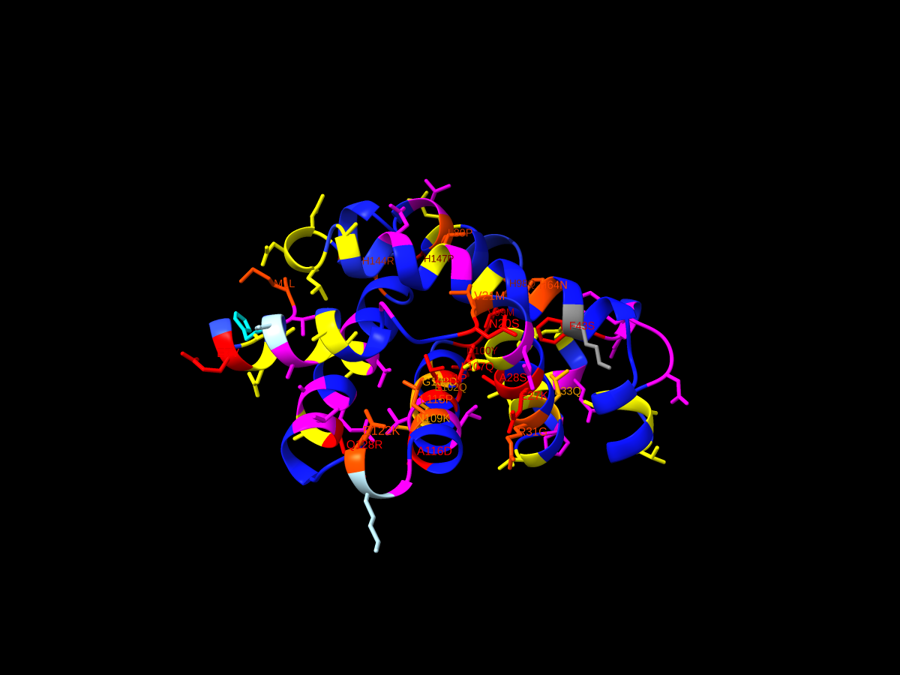

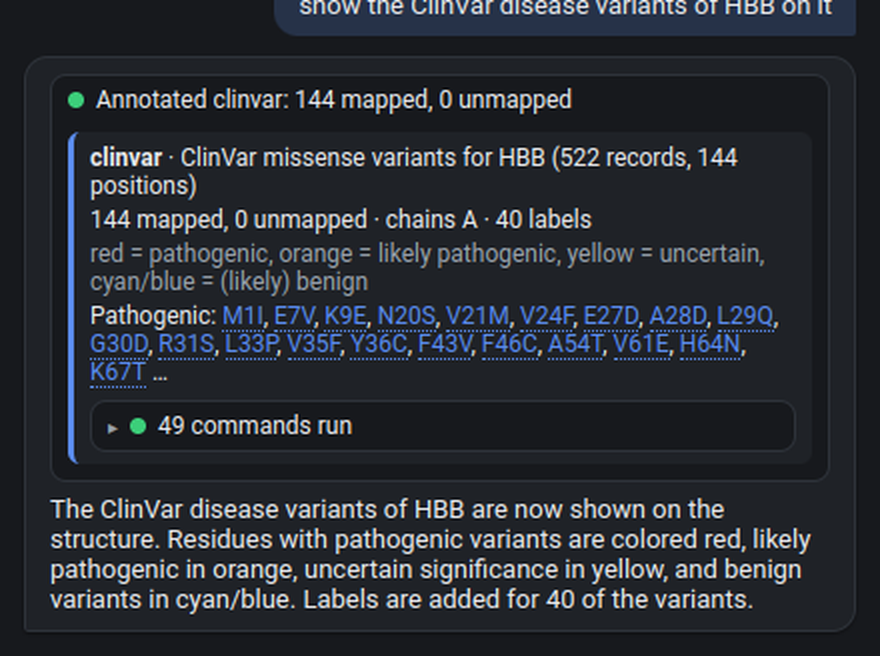

Pellaeon maps UniProt numbering onto the model's chains (PDB entries often start counting differently) and checks that the residue in the model really is the reference amino acid; mismatches are skipped and counted in the card.

<!--CLIP part6_variants_clinvar | 0:17 | Step 8, ClinVar variants on hemoglobin beta-->

### Step 8b · When labels pile up

Forty variant labels on a small protein overlap. Say so, or press **Tidy labels**:

> the labels overlap, tidy them

Pellaeon works out where every label sits on screen, moves the colliding ones to a free spot next to their residue and removes the ones that cannot fit, then tells you which. It is a fix for the current view: rotate or resize and ask again. Ask for specific residues to label those again.

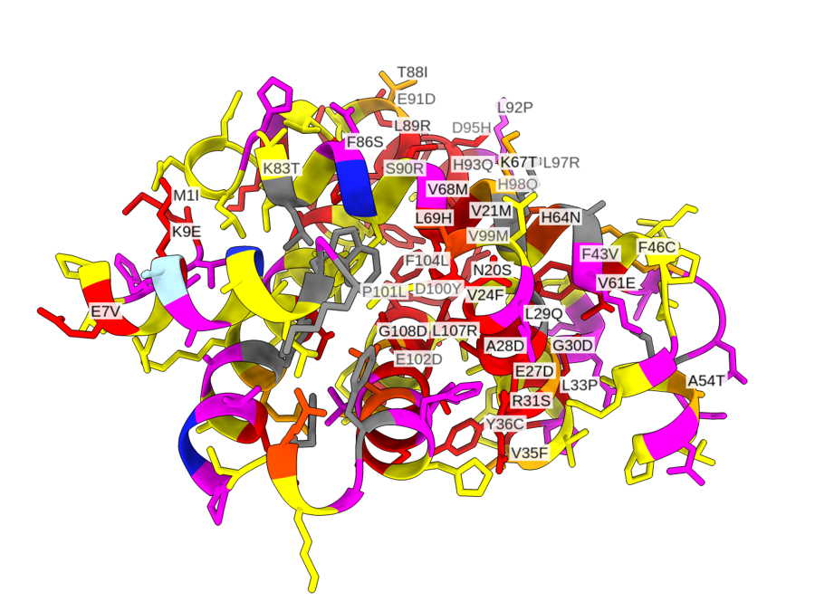

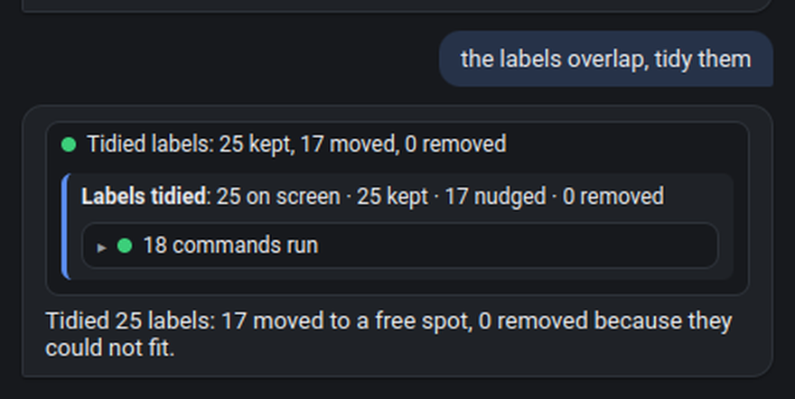

<!--CLIP part6_variants_tidy | 0:13 | Step 8b, tidy the labels-->

### Step 8c · Re-use a look

Once you have saved a figure bundle (step 5b), its styling can be applied to something else:

> open 1omp and make it look like my hemoglobin figure

Pellaeon replays the bundle's styling commands, colors, cartoon and surface style, lighting and background, on the new structure and leaves out the bundle's own open, save and close steps.

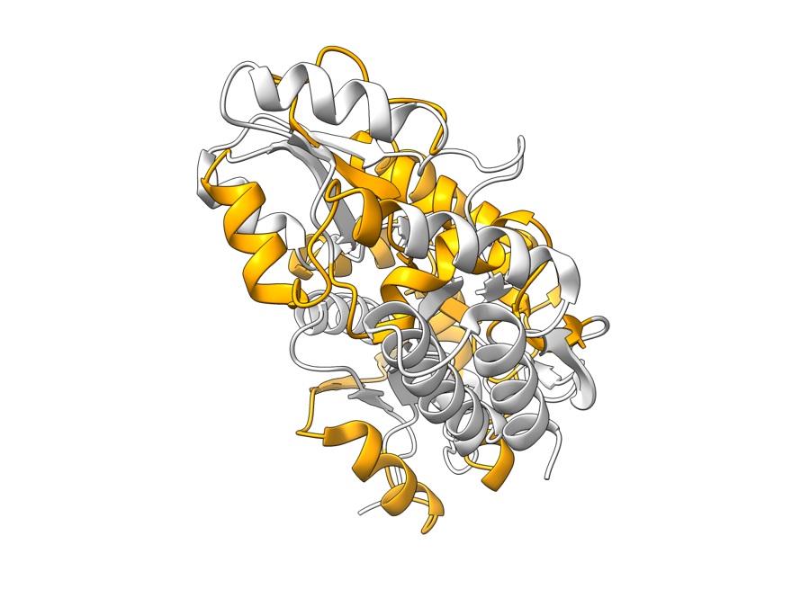

### Step 9 · Compare two conformations

Maltose-binding protein is a classic hinge: open without ligand (1omp), closed around maltose (1anf). Open both, then ask:

> close everything, open 1omp and 1anf, then compare these two models and tell me what changed

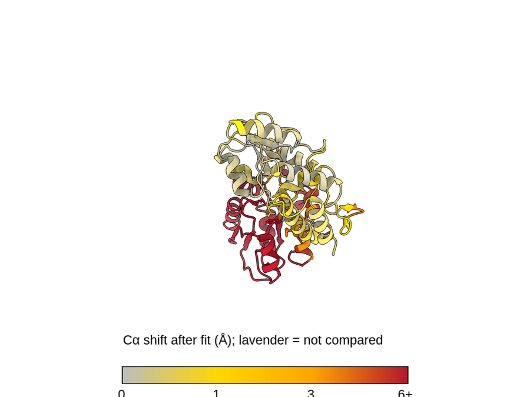

What you are looking at: the second model (closed, 1anf) after superposition on the first, shown alone and colored by how far each Cα moved between the two forms: gray under 1 Å, gold, orange, dark red 6 Å or more; a key sits in the corner. The reference is hidden; **Show reference** on the card draws it as a pale ghost on top. Gray means the residue sits close to its counterpart *after the fit*; it is not a statement about which part is the hinge.

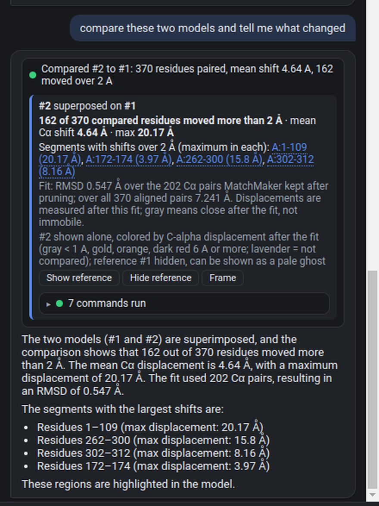

The card leads with the change: how many residues moved more than 2 Å, the mean and maximum shift, and the segments with the largest shifts (each clickable). Below it, the fit details: MatchMaker's RMSD over the Cα pairs it kept after pruning, and the RMSD over all aligned pairs. They are different numbers about different sets of atoms, which is why the card keeps them apart.

### Step 9b · Which contacts change

> which contacts are lost when it opens, and which salt bridges break?

Where step 9 asks how far residues moved, this asks what they stopped touching. Pellaeon collects every residue-residue contact in both conformations, matches them through the same alignment, and draws the lost ones as red dashes on the closed form and the gained ones green on the open form, with a key. The result lists lost and gained contacts and the residues involved, which salt bridges broke, and where the change clusters. Add "for the ligand" to see only what the ligand touches in one form but not the other.

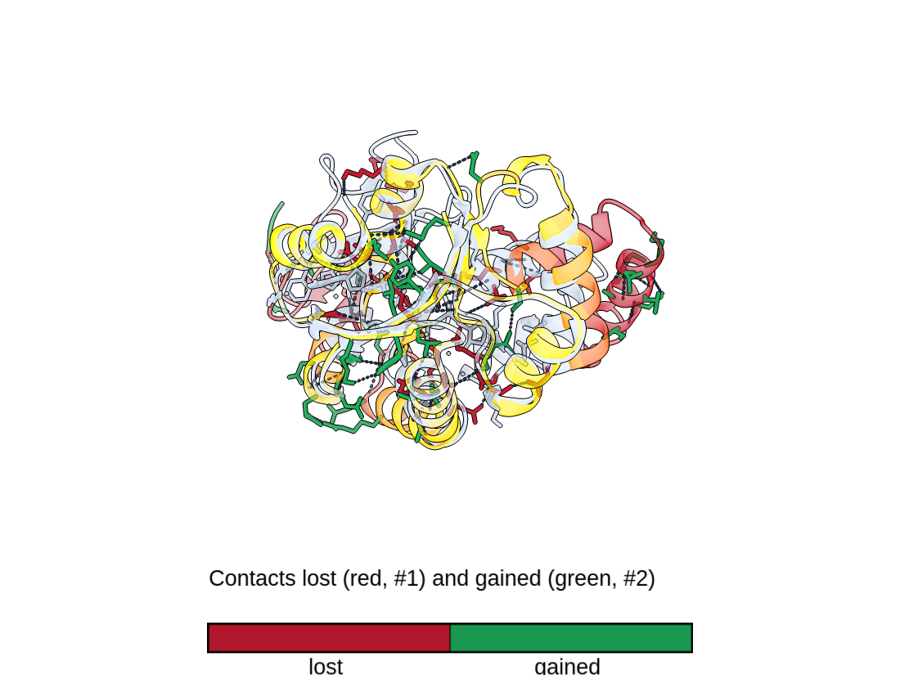

### Step 10 · Risky commands ask first

> close everything

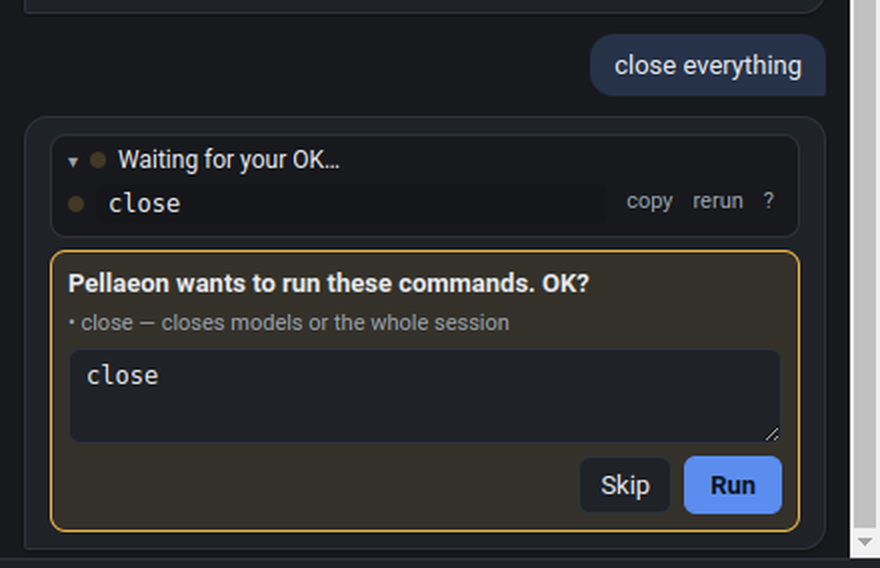

By default, closing models, deleting atoms, saving files, and running scripts require confirmation. The card shows the exact commands and they are editable: **Run** or **Skip**; Skip leaves everything as it was. The drop-down at the top of the panel sets when Pellaeon asks: *Ask for risky ones* (the default), *Ask every time*, or *Never ask*.

<!--CLIP part7_safety_skip | 0:20 | Step 10, the confirmation card and Skip-->

### Step 11 · Your own data on the structure

Any per-residue table can be painted onto a structure: conservation scores, deep mutational scanning, contact changes, your own residue groups. The table needs a residue-position column; a chain column, a reference-residue column (wild-type amino acid) and an accession column are used when present.

1. Open a structure (`open 1ubq`), then press the **Import table** button (⊞) in the panel header and pick a CSV or TSV. [ubiquitin_hydropathy.csv](examples/ubiquitin_hydropathy.csv) is a small example: Kyte-Doolittle hydropathy for every residue of ubiquitin.
2. A card shows what Pellaeon detected: the position column, the reference-residue column, the chain column, and a few sample rows. For the example: column `hydropathy`, model `#1`, chain left empty, numbering `structure`, palette `blue-white-red`, then **Apply**. Expect 76 residues placed and no reference mismatches. Positive Kyte-Doolittle values are hydrophobic (red), negative hydrophilic (blue); a key appears in the 3D view.

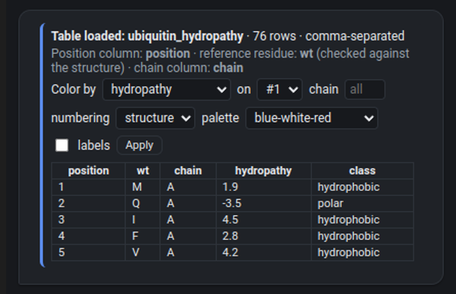

3. The result card says how many rows were placed, which positions do not exist in the structure, and how many rows were **skipped because the reference residue did not match** the structure. A wrong numbering shows up here as a wall of mismatches instead of a silently wrong picture. Numeric columns get a color ramp (residues without a value stay gray), text columns get one color per category.
4. The AI now knows about the table, so you can ask in words. Applied tables appear as **Layers** chips above the composer; click one to re-apply it after other coloring.

> label the residues with hydropathy above 3 and show them as sticks

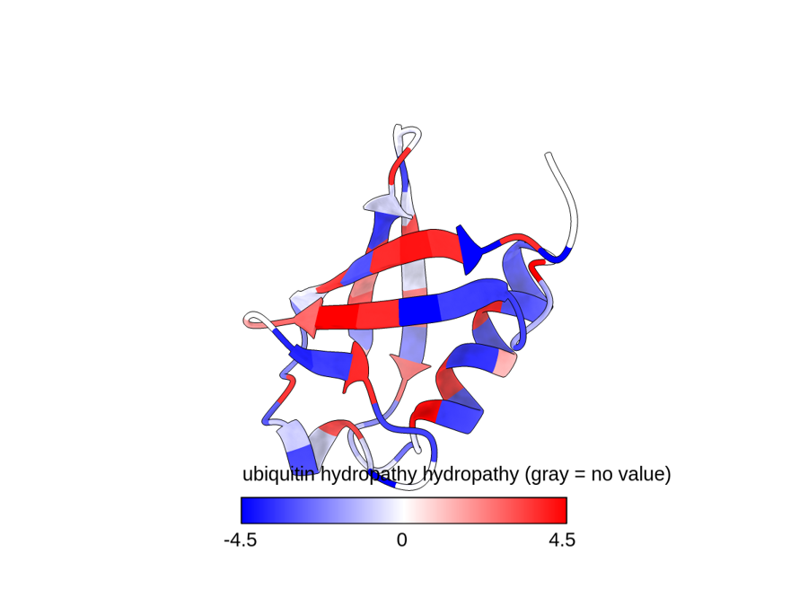

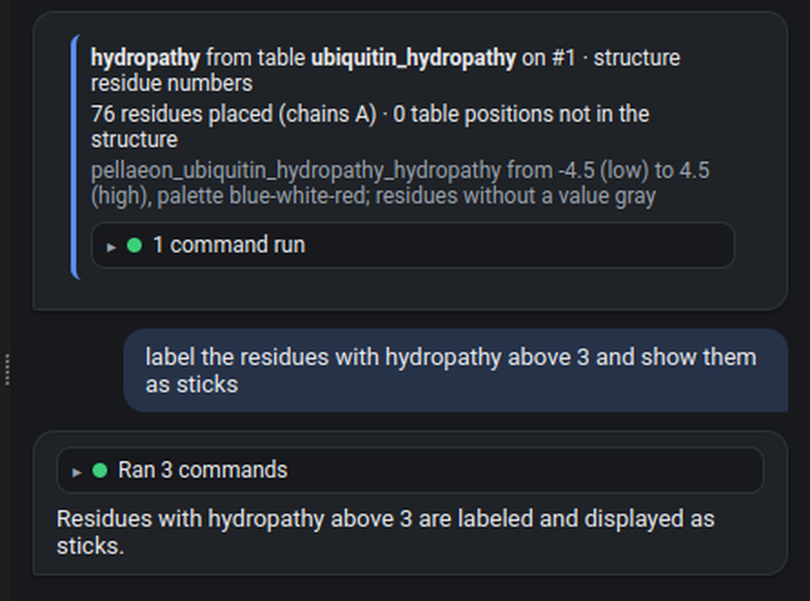

When the table does not say where it goes (no chain column, and a structure with chains of more than one protein, such as 4hhb), Pellaeon places nothing and says so; the card has one button per chain, and each places the values on that chain.

<!--CLIP part8_data_choose | 0:25 | Step 11, a table placed on the chain you choose-->

Every value is stored as a residue attribute named `pellaeon_<table>_<column>`, so ChimeraX's own attribute selection (`select ::pellaeon_ubiquitin_hydropathy_hydropathy>3`) and saved sessions work with it. Table overlays are ChimeraX-edition only.

## Part 3: Good to know

- **Undo:** the ↶ button in the panel's top bar (or the **Undo last request** chip, or "undo the last request") restores the session to its state before the previous request, from a checkpoint Pellaeon saves before each request. Its tooltip names the request it would undo. For sessions above 300,000 atoms the checkpoint holds only the list of open models, so their display is not restored. "Undo the last change" runs ChimeraX's own undo, which reverses supported actions only. Save a session (`.cxs`) before experimenting on something you care about.
- **Review the view:** the **Review the view** chip makes Pellaeon take a screenshot, judge framing, clutter, labels and colors, fix what it can and look again. Reviewing screenshots requires a vision-capable model and the review-the-view option enabled in Settings. Which models were tested for it is on the [Tested models](models.html) page.
- **What changed on screen:** each result says what the commands changed in the 3D view. A command that ran but changed nothing is marked *changed nothing* in amber, and "why is this red?" tells you which command, table or annotation gave a residue its look.
- **Labels** are drawn at a fixed size, on top of everything, with a white background, so they stay readable in screenshots; when more than twenty residues are labeled at once, one-letter codes (H87) are used. Color keys whose labels would overlap are drawn longer or with a smaller font. Ask for a specific size or color and Pellaeon uses that instead; the switch is in Settings ▸ Advanced.
- **When it gets a command wrong**, it reads ChimeraX's error and the real syntax and retries once or twice. Explain what went wrong so Pellaeon can revise the request.
- **Learned fixes:** Settings ▸ *view*, next to "Remember command fixes". When ChimeraX refuses a command and another one with the same first word runs instead, Pellaeon keeps the pair on this computer and offers it to the model when that command comes up again. **Share with the Pellaeon project…** copies the list and opens an empty GitHub page; nothing is sent unless you paste and post it.
- **Report a problem:** the **?** button opens Help. **Report a problem…** copies a report (versions, the model, the last two turns, with file paths and web addresses replaced) and opens an empty GitHub issue.
- **Export a session as a script:** the ⇩ button saves every command that actually ran as a `.cxc` file; replay it with `open myscript.cxc`.
- **Your own data:** ⊞ imports a per-residue CSV/TSV (Step 11).
- **Past chats:** ☰ lists them; + starts a new one.
- **From ChimeraX's own command line:** `pellaeon color everything by chain`.
- **Classic Chimera 1.x:** there is a separate edition, same panel in your browser. See [Classic edition](classic.html).

## Troubleshooting

| Symptom | Fix |
|---|---|
| "Ollama is not running" | Start Ollama (Windows: it is in the system tray; or run `ollama serve`), or switch to the Gemini card. |
| "model not found" | Settings ▸ **Pull** the model, or type its exact name (`ollama list` shows what you have). |
| Empty or very slow answers with Ollama | Use `qwen3:8b` on a GPU; on CPU-only PCs use `qwen3:4b` and expect 10–30 s per request. |
| "rejected the API key (401)" | Re-paste the key; check it belongs to the provider you selected. |
| Panel is blank | `Tools ▸ General ▸ Pellaeon` again, or restart ChimeraX. |
| Something changed that you did not want | Press ↶ in the panel's top bar, say "undo", or reopen the structure. |
